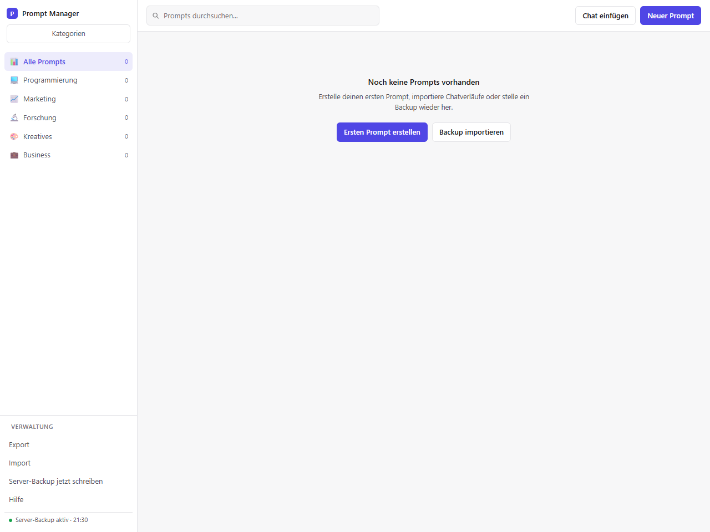
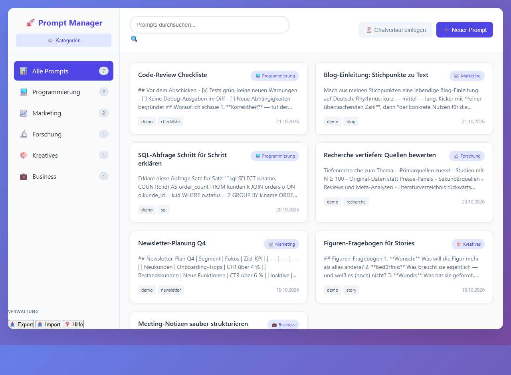
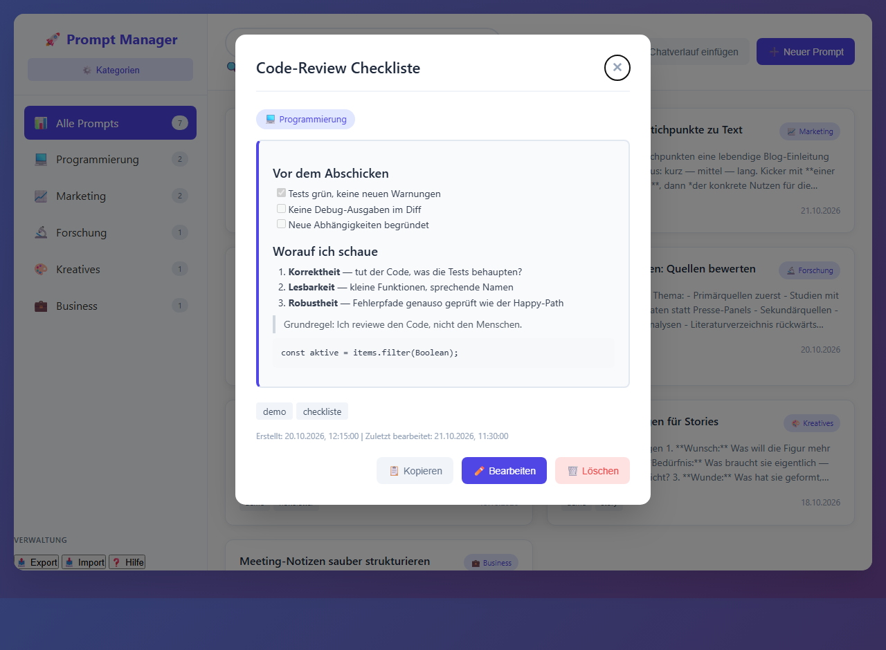
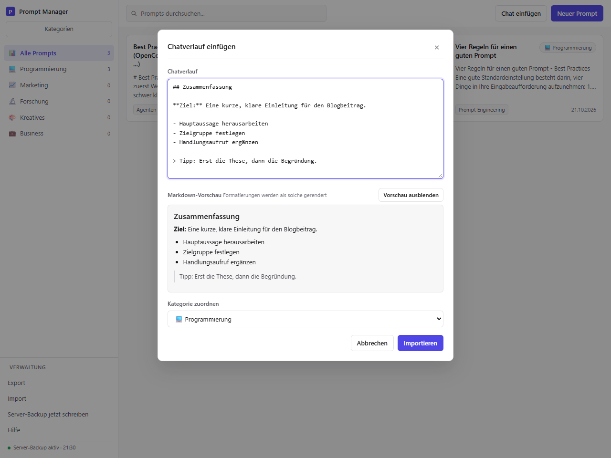

# AI Prompt Manager / KISS Design

Local AI prompt management with categories, tags, import/export, and Markdown display.

Runs entirely in the browser - everything stays on the device (LocalStorage).
No data leaves the device, and no internet connection is required (no CDN, no external requests).
The optional local server (see below) only talks to 127.0.0.1.

KISS means "Keep it simple, stupid".

## Screenshots

| First start (clean, no data) | Prompt library with categories |
| :---: | :---: |
|  |  |
| **Detail view** — Markdown rendered live | **Chat history import** — with live preview |
|  |  |

The screenshots show light mode. The app follows the operating system's light or
dark preference (`prefers-color-scheme`); there is no separate theme switch.

## Interface

The layout is deliberately plain and fills the window: neutral surfaces, hairline
borders, small radii and a single indigo accent. The sidebar holds the categories
and the storage controls; the header keeps search and the two create actions within
reach. Prompt input and code use a monospace face, everything else the system font
stack.

Prompts open in a dialog with rendered Markdown, tags, timestamps and a control for
moving them to another category. Dialogs keep focus inside, close with `Esc`, and
return focus to the element that opened them. Below 860 px the sidebar moves above
the content and the prompt grid becomes one column.

## Usage

- **Recommended start (set up once):** `npm run autostart:install`. This registers the
  server with Windows autostart and creates a desktop icon. Afterwards a single click on
  the bookmark `http://127.0.0.1:8765/` is enough - the server is already running and every
  change is saved to `prompt-manager-data.json` automatically.
  A bookmark cannot start a local program itself: browsers forbid web pages from launching
  processes. The autostart entry does that step.
- **Without the server:** Open `prompt-manager.html` directly in your browser (works
  everywhere, but then export/import is the only safety net).
- **Export / Import:** Back up data as JSON (**Export**) and restore it (**Import**).
  The import **merges rather than overwrites**: existing categories and prompts are preserved,
  new ones are added; duplicates (same ID or identical title + content) are skipped.
  Imports are validated and limited; entries with invalid fields are reported and skipped.
- **Import chat history:** Import chat histories from any chat AI (**Chat einfügen**).
  Markdown (headings, tables, lists, task lists, code, quotes, bold/italics,
  images, links) is rendered live in the preview and displayed formatted in the detail view.
- **Categories:** Use **Kategorien** to create, rename, and assign icons to categories.
  The detail view has a **move control** to move a prompt to another category.
- **File backup:** In Chromium browsers, **Backup-Datei** connects a JSON file.
  Every change is written back to that file, so the data survives browser settings
  that delete cookies and site data on close. The app restores from that file on demand.
  In Firefox and Safari the same button downloads a dated JSON backup instead
  (no error); restore it with **Import** after a restart.
- **Browser storage warning:** If no file or server backup is active, the app warns before
  closing the tab while there are unsaved changes.

## Autostart setup (Windows)

```powershell
cd <path>\tools\ai-prompt-manager
npm run autostart:install
```

The script writes two files and starts the server immediately:

| File | Purpose |
| --- | --- |
| `%APPDATA%\…\Startup\Prompt Manager (Server).vbs` | starts the server hidden at every sign-in |
| `Desktop\Prompt Manager.vbs` | starts the server on demand and opens the app |

Then open `http://127.0.0.1:8765/` in your browser and save it with `Ctrl+D`
(folder "Bookmarks Toolbar"). From then on a single click is enough.

```powershell
npm run autostart:status      # is the server running? is autostart active?
npm run autostart:uninstall   # remove autostart and the desktop icon
```

These commands must run inside the project folder. From another directory
(e.g. `C:\Windows\System32`) npm aborts with `ENOENT … package.json`. Either
change into the folder first or point npm at it:

```powershell
npm --prefix "<path>\tools\ai-prompt-manager" run autostart:status
```

The app itself shows the important state in its sidebar
("Server-Backup aktiv · HH:MM").

The server is idempotent: a second launch detects the running instance and exits
immediately instead of starting another process on the same data file.

## Data storage and backup

Data is stored in the browser's LocalStorage. **Browser settings that clear cookies
or site data on close also clear LocalStorage** - in that case the data is gone after
closing the browser unless a backup exists.

Three independent safety nets are built in:

1. **JSON export** (**Export**) downloads a dated `prompt-manager-backup-*.json`.
2. **File backup** (**Backup-Datei**) keeps a JSON file outside the browser and updates it after
   every change. Requires the File System Access API (Chrome, Edge, Chromium;
   in Brave it is currently behind a flag). In Firefox and Safari the same button
   downloads a dated JSON backup instead; restore it with **Import**.
3. **Local server** (`node serve.mjs`) keeps the data in `prompt-manager-data.json` on disk
   and updates it after every change. This works in Firefox and Safari, where the File System
   Access API is unavailable. The server only listens on 127.0.0.1 and requires a per-session token.
   Make it permanent with `npm run autostart:install`.

On startup with an empty LocalStorage, the app shows a restore banner and an
import button in the empty state. Existing backups remain importable.

`prompt-manager-backup-*.json`, `prompt-manager-data.json` and its `.bak` are gitignored
because they may contain personal content.

## Security and privacy

- **Offline guarantee:** The page loads no external scripts, styles, fonts, or images.
  The CSP restricts connections to the same origin (`connect-src 'self'`); the optional
  local server uses only 127.0.0.1, and the standalone file makes no requests at all.
  `img-src data:` and `default-src 'none'` remain in force.
- **External images in Markdown are not loaded.** They are rendered as a link marked
  "(external, not loaded)"; only embedded `data:image/...` raster images are displayed.
- **HTML is escaped** in prompts, categories, tags, and Markdown. Attribute values
  escape quotes; links allow only `http(s)`, `mailto`, relative paths, and fragments.
  `javascript:`, `data:`, `file:`, and protocol-relative URLs are blocked.
- **Import validation:** schema checks, size limits (25 MB file, 10,000 prompts,
  500 categories), field normalization, and content truncation at 50,000 characters.

## Limits

| Field | Limit |
| --- | --- |
| Title | 100 characters |
| Content | 50,000 characters |
| Tags | 20 per prompt, 40 characters each |
| Category name | 50 characters |
| Import file | 25 MB |

## Development

Requirements: Node.js 20 or newer. There are no npm dependencies.

```powershell
npm test          # behavior tests (node:test + node:vm, no browser needed)
npm run check     # static checks: syntax, CSP, offline limits, IDs, handlers
npm run verify    # both
npm start         # server in the foreground (development)
npm run open      # start the server only if needed, open the browser
npm run autostart:install     # autostart entry + desktop icon
npm run autostart:status      # server and autostart state
npm run autostart:uninstall   # remove both
bash scripts/hooks-testrun.sh   # five pre-push hook probes (Git Bash)
```

Git hooks (local secret scan, privacy guard, test gate) come from the shared
template and are activated per clone:

```powershell
git config core.hooksPath .githooks
```

The gate runs `node scripts/check.mjs`, `actionlint`, and `npm test`. The hooks
additionally need `gitleaks` and `actionlint` (`winget install Gitleaks.Gitleaks
rhysd.actionlint`); `pre-push` fails closed when `gitleaks` is missing. CI runs the
same tests on Ubuntu and Windows, checks the workflows with actionlint, and runs
the privacy/secret hook for every push and pull request.

`README.md` and `README_de.md` are published with the app. `CHANGELOG.md`,
`PLANUNG.md` and `COMPACTIONS.md` are local workspace documents: they are ignored
by Git and never pushed. `npm run check` validates the READMEs and, when the local
files exist, their LF endings, headings and the changelog section for the current
`package.json` version; it also fails if a local document becomes tracked.

The application exposes a small test surface as `window.PromptManager`
(Markdown renderer, URL sanitizer, import validation, merge and move logic).
Tests load the real inline script from `prompt-manager.html`; there is no copy
of the implementation in the test suite. `tests/server.test.mjs` starts the
local server on an ephemeral port and checks token auth, persistence, backups,
path handling and rebinding guards; `tests/install.test.mjs` verifies the
generated autostart scripts, paths and option parsing.

## License

Copyright (C) 2026 pskraemer11

This program is free software: You may redistribute and/or modify it under the terms of the GNU
General Public License, as published by the Free Software Foundation,
either under Version 3 of the License or
(at your option) any later version. The full text of the license is available at
[LICENSE](LICENSE).

SPDX-License-Identifier: GPL-3.0-or-later

*Note:* The GPL does not require the publication of contact information; if you wish, you may include
a contact address in the license notice—on GitHub, a profile link is usually sufficient.
