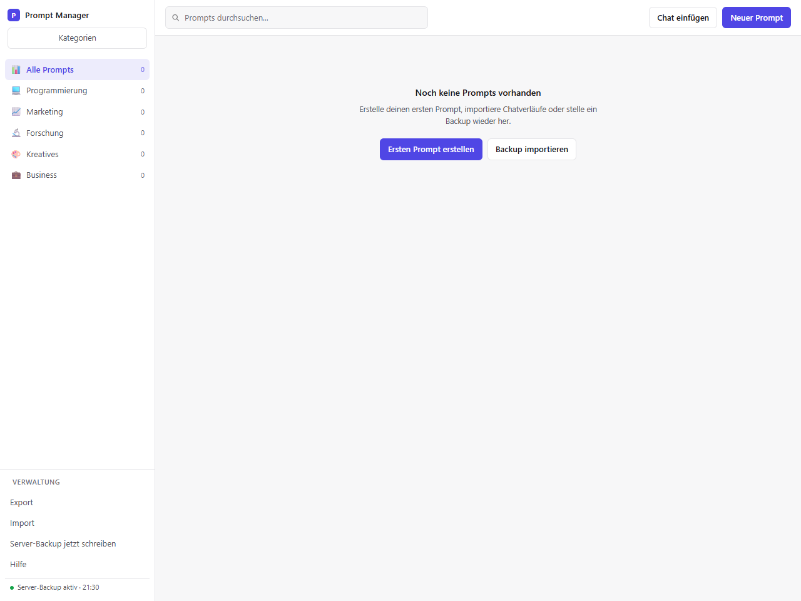
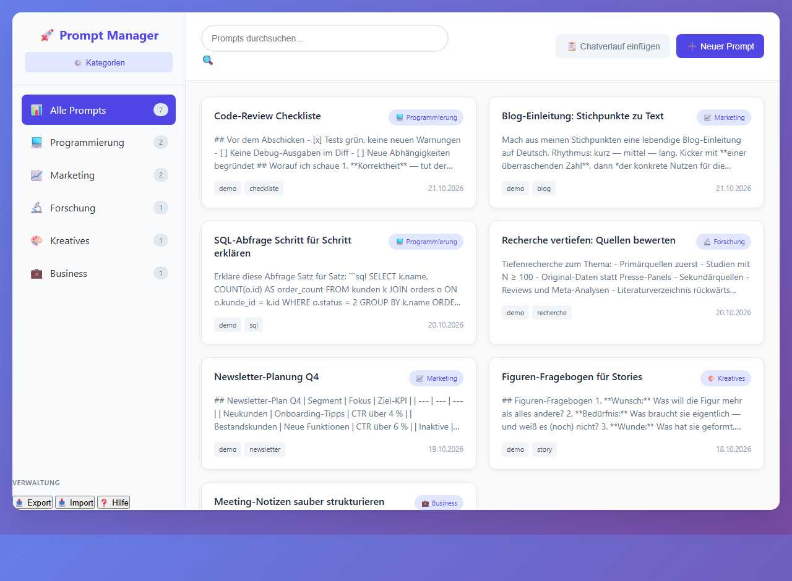
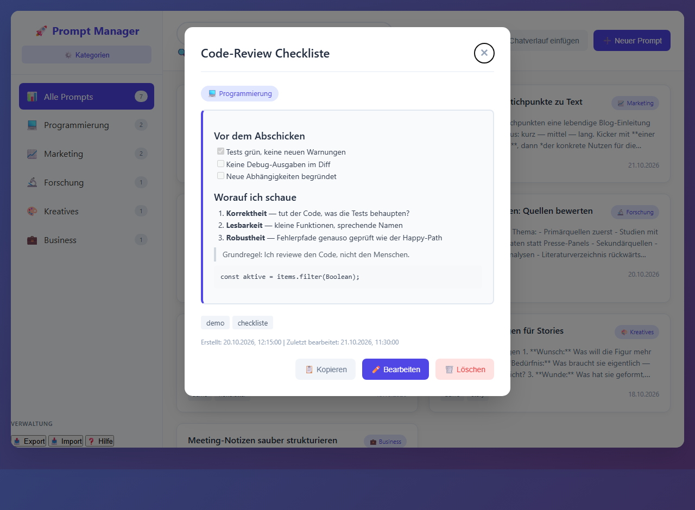
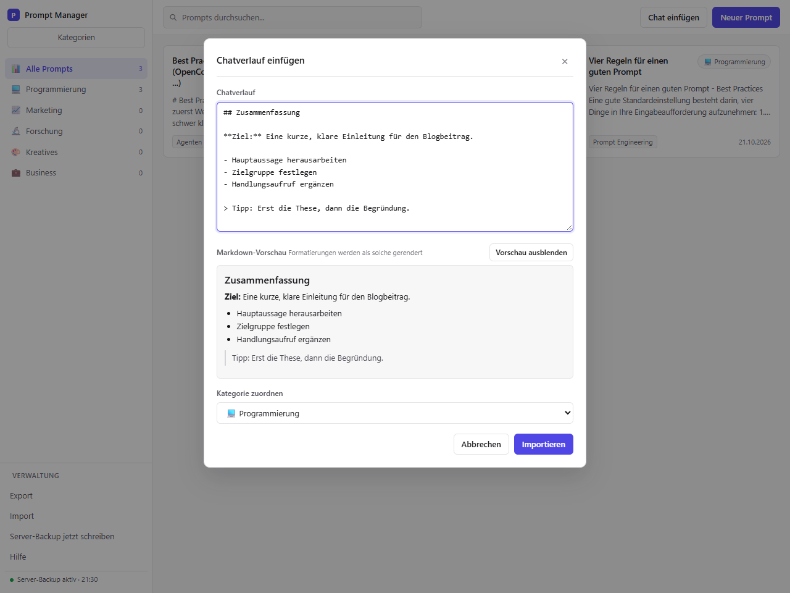

# AI Prompt Manager / KISS Design

Lokale Verwaltung von KI-Prompts mit Kategorien, Tags, Import-/Exportfunktionen und Markdown-Anzeige.

Läuft vollständig im Browser – alle Daten bleiben auf dem Gerät (LocalStorage).
Es verlassen keine Daten das Gerät, und es ist keine Internetverbindung erforderlich (kein CDN, keine externen Anfragen).
Der optionale lokale Server (siehe unten) spricht ausschließlich mit 127.0.0.1.

KISS steht für „Keep it simple, stupid“.

## Screenshots

| Erster Start (leer, ohne Daten) | Prompt-Bibliothek mit Kategorien |
| :---: | :---: |
|  |  |
| **Detailansicht** — Markdown live gerendert | **Chatverlauf einfügen** — mit Live-Vorschau |
|  |  |

Die Screenshots zeigen den hellen Modus. Die App folgt der Systemeinstellung
(`prefers-color-scheme`); einen eigenen Theme-Schalter gibt es nicht.

## Oberfläche

Das Layout ist bewusst schlicht und füllt das Fenster: neutrale Flächen,
Haarlinien, kleine Radien und ein einziger Indigo-Akzent. Die Seitenleiste enthält
Kategorien und Speicherbefehle; die Kopfzeile hält Suche und die beiden
Anlage-Aktionen griffbereit. Prompt-Eingabe und Code nutzen Monospace, alles andere
die Systemschrift.

Prompts öffnen sich in einem Dialog mit gerendertem Markdown, Tags, Zeitstempeln
und einer Auswahl zum Verschieben in eine andere Kategorie. Dialoge halten den
Fokus, schließen mit `Esc` und geben ihn an das auslösende Element zurück. Unter
860 px rutscht die Seitenleiste über den Inhalt, das Prompt-Raster wird einspaltig.

## Benutzung

- **Start (empfohlen, einmal einrichten):** `npm run autostart:install`. Das richtet den
  Server im Windows-Autostart ein und legt ein Symbol auf dem Desktop ab. Danach genügt
  ein Klick auf das Lesezeichen `http://127.0.0.1:8765/` – der Server läuft bereits,
  jede Änderung wird automatisch in `prompt-manager-data.json` gesichert.
  Warum ein Lesezeichen keinen Server starten kann: Browser dürfen aus einer Webseite
  heraus keine lokalen Programme ausführen. Der Autostart übernimmt diesen Schritt.
- **Start ohne Server:** `prompt-manager.html` direkt im Browser öffnen (funktioniert
  überall, dann nur Export/Import als Sicherung).
- **Export / Import:** Daten als JSON sichern (**Export**) und wiederherstellen (**Import**).
  Der Import **mischt statt überschreibt**: bestehende Kategorien und Prompts bleiben erhalten,
  neue kommen dazu; Doppelungen (gleiche ID oder identischer Titel + Inhalt) werden übersprungen.
  Importe werden geprüft und begrenzt; Einträge mit ungültigen Feldern werden gemeldet und übersprungen.
- **Chatverlauf einfügen:** Chatverläufe aus beliebigen Chat-KIs einfügen (**Chat einfügen**).
  Markdown (Überschriften, Tabellen, Listen, Task-Listen, Code, Zitate, Fett/Kursiv,
  Bilder, Links) wird live in der Vorschau gerendert und in der Detailansicht formatiert angezeigt.
- **Kategorien:** über den Button **Kategorien** anlegen, umbenennen, mit Icon versehen.
  In der Detailansicht gibt es eine **Verschiebe-Auswahl**, um einen Prompt einer anderen Kategorie zuzuordnen.
- **Datei-Backup:** In Chromium-Browsern verbindet **Backup-Datei** eine JSON-Datei.
  Jede Änderung wird in diese Datei geschrieben; damit überleben die Daten auch
  Browsereinstellungen, die beim Schließen Cookies und Website-Daten löschen.
  Die App stellt die Daten auf Wunsch aus dieser Datei wieder her.
  In Firefox und Safari lädt derselbe Button stattdessen ein datiertes JSON-Backup
  herunter (keine Fehlermeldung); nach einem Neustart über **Import** wiederherstellen.
- **Browser-Speicher-Warnung:** Ohne aktives Datei- oder Server-Backup warnt die App beim
  Schließen, wenn Änderungen noch nicht gesichert wurden.

## Autostart einrichten (Windows)

```powershell
cd <Pfad>\tools\ai-prompt-manager
npm run autostart:install
```

Das Skript legt zwei Dateien an und startet den Server sofort:

| Datei | Zweck |
| --- | --- |
| `%APPDATA%\…\Startup\Prompt Manager (Server).vbs` | startet den Server unsichtbar bei jeder Anmeldung |
| `Desktop\Prompt Manager.vbs` | startet den Server bei Bedarf nach und öffnet die App |

Danach `http://127.0.0.1:8765/` im Browser öffnen und mit `Strg+D` als Lesezeichen
ablegen (Ordner „Lesezeichen-Symbolleiste“). Ab dann genügt ein Klick.

```powershell
npm run autostart:status      # läuft der Server? ist der Autostart aktiv?
npm run autostart:uninstall   # Autostart und Desktop-Symbol entfernen
```

Die Befehle müssen im Projektordner laufen. Aus einem anderen Verzeichnis
(z. B. `C:\Windows\System32`) bricht npm mit `ENOENT … package.json` ab. Dann
entweder in den Ordner wechseln oder den Ordner vorgeben:

```powershell
npm --prefix "<Pfad>\tools\ai-prompt-manager" run autostart:status
```

Den wichtigsten Zustand zeigt ohnehin die App selbst in der Seitenleiste
(„Server-Backup aktiv · HH:MM").

Der Server ist idempotent: Ein zweiter Start erkennt die laufende Instanz und beendet
sich sofort, statt einen zweiten Prozess auf dieselbe Datei zu setzen.

## Datenspeicherung und Backup

Die Daten liegen im LocalStorage des Browsers. **Browsereinstellungen, die beim Schließen
Cookies oder Website-Daten löschen, löschen auch den LocalStorage** – ohne Backup sind die
Daten danach weg.

Drei voneinander unabhängige Sicherungen sind eingebaut:

1. **JSON-Export** (**Export**) lädt ein datiertes `prompt-manager-backup-*.json` herunter.
2. **Datei-Backup** (**Backup-Datei**) hält eine JSON-Datei außerhalb des Browsers aktuell.
   Voraussetzung ist die File System Access API (Chrome, Edge, Chromium;
   in Brave derzeit hinter einem Flag). In Firefox und Safari lädt derselbe
   Button stattdessen ein datiertes JSON-Backup herunter; Wiederherstellung
   über **Import**.
3. **Lokaler Server** (`node serve.mjs`) hält die Daten in `prompt-manager-data.json`
   auf der Festplatte aktuell. Das funktioniert in Firefox und Safari, wo die
   File System Access API fehlt. Der Server lauscht nur auf 127.0.0.1 und
   verlangt ein Token pro Sitzung. Dauerhaft verfügbar über `npm run autostart:install`.

Beim Start mit leerem LocalStorage zeigt die App einen Wiederherstellungs-Hinweis
und im leeren Zustand einen Import-Button. Bestehende Backups bleiben importierbar.

`prompt-manager-backup-*.json`, `prompt-manager-data.json` und die `.bak` sind gitignored,
weil sie persönliche Inhalte enthalten können.

## Sicherheit und Datenschutz

- **Offline-Zusage:** Die Seite lädt keine externen Skripte, Styles, Fonts oder Bilder.
  Die CSP erlaubt Verbindungen nur zur eigenen Origin (`connect-src 'self'`); der optionale
  lokale Server nutzt ausschließlich 127.0.0.1, die Einzeldatei stellt gar keine Anfragen.
  `img-src data:` und `default-src 'none'` bleiben in Kraft.
- **Externe Bilder in Markdown werden nicht geladen.** Sie erscheinen als Link mit dem
  Hinweis „(extern, nicht geladen)“; nur eingebettete `data:image/...`-Rasterbilder werden angezeigt.
- **HTML wird escaped** in Prompts, Kategorien, Tags und Markdown. Attributwerte escapen
  Anführungszeichen; Links erlauben nur `http(s)`, `mailto`, relative Pfade und Fragmente.
  `javascript:`, `data:`, `file:` und protokollrelative URLs werden blockiert.
- **Importprüfung:** Schema-Prüfung, Größenlimits (25 MB Datei, 10.000 Prompts,
  500 Kategorien), Feldnormalisierung und Kürzung von Inhalten auf 50.000 Zeichen.

## Grenzen

| Feld | Limit |
| --- | --- |
| Titel | 100 Zeichen |
| Inhalt | 50.000 Zeichen |
| Tags | 20 pro Prompt, je 40 Zeichen |
| Kategoriename | 50 Zeichen |
| Importdatei | 25 MB |

## Entwicklung

Voraussetzung: Node.js 20 oder neuer. Es gibt keine npm-Abhängigkeiten.

```powershell
npm test          # Verhaltenstests (node:test + node:vm, ohne Browser)
npm run check     # statische Prüfung: Syntax, CSP, Offline-Grenzen, IDs, Handler
npm run verify    # beides
npm start         # Server im Vordergrund (Entwicklung)
npm run open      # Server bei Bedarf starten, Browser öffnen
npm run autostart:install     # Autostart + Desktop-Symbol einrichten
npm run autostart:status      # Zustand von Server und Autostart
npm run autostart:uninstall   # beides wieder entfernen
bash scripts/hooks-testrun.sh   # fünf Proben für den pre-push-Hook (Git-Bash)
```

Die Git-Hooks (lokaler Secret-Scan, Privacy-Guard, Test-Gate) stammen aus der
gemeinsamen Vorlage und werden pro Klon aktiviert:

```powershell
git config core.hooksPath .githooks
```

Das Gate führt `node scripts/check.mjs`, `actionlint` und `npm test` aus. Die Hooks
benötigen zusätzlich `gitleaks` und `actionlint` (`winget install Gitleaks.Gitleaks
rhysd.actionlint`); `pre-push` blockiert ohne `gitleaks` (fail closed). Die CI
testet auf Ubuntu und Windows, prüft die Workflows mit actionlint und führt die
Privacy-/Secret-Prüfung für jeden Push und Pull Request aus.

`README.md` und `README_de.md` werden mit der App veröffentlicht. `CHANGELOG.md`,
`PLANUNG.md` und `COMPACTIONS.md` sind lokale Arbeitsdokumente: Sie sind per Git
ignoriert und werden nie gepusht. `npm run check` prüft die READMEs und, sofern
die lokalen Dateien vorhanden sind, deren LF-Zeilenenden, Überschriften und den
Changelog-Abschnitt für die aktuelle `package.json`-Version; der Check schlägt
außerdem fehl, wenn ein lokales Dokument versioniert wird.

Die Anwendung stellt eine kleine Testfläche als `window.PromptManager` bereit
(Markdown-Renderer, URL-Sanitizer, Importprüfung, Merge- und Verschiebe-Logik).
Die Tests laden das echte Inline-Skript aus `prompt-manager.html`; es gibt keine
Kopie der Implementierung in der Testsuite. `tests/server.test.mjs` startet den
lokalen Server auf einem freien Port und prüft Token-Auth, Persistenz, Sicherung,
Pfadbehandlung und Rebinding-Schutz; `tests/install.test.mjs` prüft die erzeugten
Autostart-Skripte, Pfade und die Optionsauswertung.

## Lizenz

Copyright (C) 2026 pskraemer11

Dieses Programm ist freie Software: Sie können es unter den Bedingungen der GNU
General Public License, wie von der Free Software Foundation veröffentlicht,
weitergeben und/oder modifizieren, und zwar unter Version 3 der Lizenz oder
(nach Ihrer Option) jeder späteren Version. Der vollständige Lizenztext steht in
[LICENSE](LICENSE).

SPDX-License-Identifier: GPL-3.0-or-later

*Hinweis:* Die GPL verlangt kein Veröffentlichen von Kontaktdaten; wer will, ergänzt
im Lizenzhinweis eine Kontaktadresse — bei GitHub reicht üblicherweise der Profil-Link.
